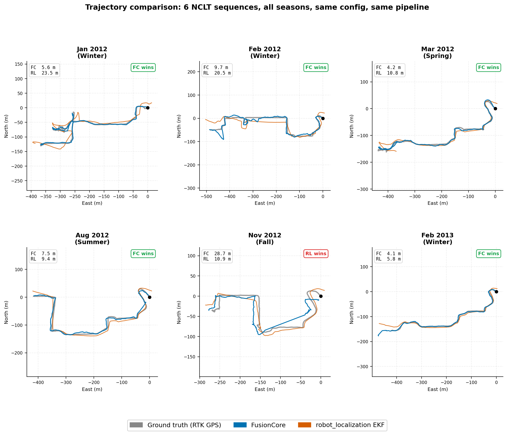

# NCLT benchmark history, May to October 2026

Moved verbatim from the README on 2026-11-07, when the robot_localization re-run finished and the
README's Benchmark section was reduced to the current measurement. **Everything below is superseded.**
It is kept so every withdrawn number and every correction stays visible. The current numbers are
in the README Benchmark section and in `tools/eval_20261025_results.md`.

Links below are adjusted to this file's location; the text is otherwise unchanged.

> **Status, 2026-10-25. SUPERSEDED by the 2026-10-26 note above, which re-measures the same twelve sequences with the corrected player.**
>
> Scored at GPS fix times on all 12 NCLT sequences, the shipped default does not beat raw
> GPS: raw GPS is better on 11 and tied (within 0.2%) on the twelfth. With opt-in
> re-anchoring (`gnss.reanchor_enabled`), FusionCore beats raw GPS on 2 of 12: 2012-03-31
> by 22.4% and 2012-10-28 by 5.4%, both held-out sequences never used for tuning. On the
> held-out set, scored over the full trajectory, re-anchoring lowers RMSE on 6 of 7 and
> raises it on none, including 2012-01-08 going from 178.2 m to 17.0 m. It also raises
> median error by 3.3% and 4.4% on two sequences and jitter on one, which is why it is off
> by default.
>
> ATE RMSE (3D) at GPS fix times, all three columns on identical timestamps:
>
> | Sequence | Set | Raw GPS | FusionCore, shipped default | FusionCore, re-anchoring on | Re-anchoring on, ratio to raw GPS |
> |---|---|---|---|---|---|
> | 2012-01-08 | held out | 9.883 m | 170.643 m | 10.891 m | 1.102x |
> | 2012-02-04 | dev | 57.564 m | 151.937 m | 59.303 m | 1.030x |
> | 2012-03-31 | held out | 13.824 m | 15.206 m | **10.726 m** | 0.776x |
> | 2012-05-11 | held out | 9.186 m | 9.166 m | 9.166 m | 0.998x |
> | 2012-06-15 | dev | 9.293 m | 12.469 m | 12.469 m | 1.342x |
> | 2012-08-20 | dev | 34.250 m | 193.923 m | 39.782 m | 1.162x |
> | 2012-09-28 | dev | 8.960 m | 21.560 m | 10.166 m | 1.135x |
> | 2012-10-28 | held out | 13.921 m | 15.057 m | **13.170 m** | 0.946x |
> | 2012-11-04 | held out | 20.267 m | 27.319 m | 22.535 m | 1.112x |
> | 2012-12-01 | held out | 12.681 m | 16.149 m | 12.731 m | 1.004x |
> | 2013-02-23 | held out | 15.719 m | 17.435 m | 15.780 m | 1.004x |
> | 2013-04-05 | dev | 8.624 m | 9.981 m | 8.774 m | 1.017x |
>
> How these were produced, so they can be reproduced: the deterministic offline replay of
> the shipped NCLT config, fusing the IMU orientation exactly as the ROS node does (on
> 2012-01-08 that reproduces the node to 0.3%), scored by `tools/score_raw_vs_fc.py`
> (version `ed061b2ff01a`, which prints that hash on every row) through `hardware/ate_tum.py`.
> "Held out" sequences were never used to develop or tune anything; the rule they were
> tested under was committed before their logs existed (`tools/ship_rule.md`). The
> 2026-10-18 table below could not be reproduced: its files survive but the scoring step
> that produced its numbers does not, so it is kept only as history.

> **Status, 2026-10-18. SUPERSEDED by the 2026-10-25 note above; its table could not be reproduced and is kept as history.**
>
> **The baseline this table never had: raw, unfiltered GNSS.** Take the fixes straight out
> of the log, score them as a trajectory, and compare. Scored at identical points, both
> through the same scorer, five sequences (2012-01-08 is excluded, see the withdrawal
> below):
>
> | Sequence | Raw GNSS | FusionCore, before | FusionCore, after | After, as ratio to raw GNSS |
> |---|---|---|---|---|
> | 2012-02-04 | 58.672 m | 144.903 m | **60.522 m** | 1.03x |
> | 2012-06-15 | 9.046 m | 10.945 m | 10.945 m | 1.21x |
> | 2012-08-20 | 32.238 m | 176.805 m | **39.397 m** | 1.22x |
> | 2012-09-28 | 8.983 m | 23.956 m | **9.866 m** | 1.10x |
> | 2013-04-05 | 8.561 m | 10.149 m | **8.752 m** | 1.02x |
>
> **Unfiltered GNSS has a lower ATE RMSE than FusionCore on all five sequences, before and
> after.** That is the first thing a careful reader should check and it was not anywhere in
> this repository until now. Before the fix below, fusing made the answer 1.19x to 5.48x
> worse than not fusing. After it, 1.02x to 1.22x worse.
>
> The medians say where the remaining gap lives. Each filter median as a percentage of the
> raw GNSS median on the same sequence:
>
> | Sequence | Raw GNSS median | Before | After |
> |---|---|---|---|
> | 2012-02-04 | 13.817 m | +154.1% | **-0.4%** |
> | 2012-06-15 | 4.937 m | +0.4% | +0.4% |
> | 2012-08-20 | 7.337 m | +444.1% | +3.0% |
> | 2012-09-28 | 6.289 m | +14.2% | +1.6% |
> | 2013-04-05 | 6.287 m | +2.1% | +1.9% |
>
> After the fix every median is within 3.1% of unfiltered GNSS and four of the five are
> within 2%, with 2012-02-04 slightly better than unfiltered. Before it, two sequences were
> 154% and 444% out. So **typical-case accuracy now matches doing no filtering at all, and
> the entire remaining RMSE gap is excursions**, which is a sharper statement than the RMSE
> ratio alone.
>
> **Where the error actually was.** Classifying each sequence by whether a GNSS fix was
> available, using windows taken from the raw fix stream so the classification does not
> depend on the thing being measured, 74.8% to 96.8% of squared error sat in the blackouts or
> in the re-convergence right after them. On 2012-02-04, 44.5% of the run was spent
> re-converging and that window held 94.5% of the error.
>
> **The cause.** During re-convergence the outlier gate rejected 81% of arriving fixes on
> 2012-02-04 and 2012-08-20, against 10% across the rest of the run, while adaptive R
> inflated the measurement noise up to 4,907x. The filter was discarding and discounting
> precisely the fixes that would have corrected it, because its own covariance said it was
> confident and the fixes disagreed. A filter that is wrong and certain rejects the
> evidence that it is wrong.
>
> **The fix**, `gnss.reanchor_enabled`, default off: when the gate has been refusing most
> of what arrives, and the recent fixes are self-consistent against wheel odometry, jump
> the state onto them instead of waiting for the gate to let them in. Full trajectory:
> 2012-02-04 142.792 to 59.689, 2012-08-20 171.393 to 46.671, 2012-09-28 23.638 to 10.008,
> 2013-04-05 16.677 to 16.011, 2012-06-15 unchanged at 78.139. No sequence regresses on
> RMSE. 16 re-anchors across five sequences and roughly 25,000 s of driving; the smallest
> error any of them fired at was 138 m, so none fires while the filter is healthy.
>
> **What is still not true, stated plainly:**
> - FusionCore does not beat unfiltered GNSS on RMSE on any of these five sequences.
> - 2012-06-15 does not move, because 84.6% of its error is inside one 462 s blackout and
>   re-anchoring acts only after a blackout ends. Error accumulated during a blackout is
>   dead reckoning drift and is untouched by this work.
> - Whether the filter's coast beats plain dead reckoning during a blackout **cannot be
>   answered on NCLT**: its ground truth covers only 18% of GNSS gap time and 2 of 5
>   sequences have no ground truth at all inside their gaps, because NCLT's own ground
>   truth degrades under the conditions that take the GNSS out.
> - 2012-09-28's path length ratio gets **worse** with the fix on, 1.048 to 1.106, while
>   its RMSE improves 2.36x. If your consumer integrates the path rather than reading the
>   pose, that trade matters.
> - The bimodal `ukf.q_angular_vel` behaviour, where a 33% parameter change flips the
>   filter between a path ratio near 1.0 and near 0.17, is **not** fixed by this and is
>   still open.
>
> **Withdrawn here:** every replay figure for 2012-01-08 measured on 2026-10-18, because
> that export covers 66% of the sequence (3740 s of 5640 s). The 185.2 m node figure in the
> table below is a full-trajectory run and stands. Also withdrawn, from internal notes
> rather than this page: a claim that dead reckoning beat the filter's coast by 3.4x, which
> compared 462 s of integration against 276 s of ground truth.
>
> Measurement detail, including the ablation that turned the persistent-bias trigger off
> and the seven labelling errors found and corrected on 2026-10-17, is in
> `tools/benchmark_regression.md`.
>
> **Status, 2026-10-17, and this supersedes the dated notes below it.** **Nine of the
> twelve rows now have a run record** on corrected input. **FusionCore wins four and loses
> five.** The four rows added since the 2026-10-10 note were measured on 2026-10-12 at
> **n=1 each**, and two of them flip a published win to a loss:
>
> | Sequence | Published (May 2026) | Measured 2026-10-12 | |
> |---|---|---|---|
> | 2012-01-08 | FC 18.6 m, RL 41.2 m, **FC +55%** | FC 185.2 m, RL 22.8 m, **RL +88%** | flips, and it is the largest flip on record here |
> | 2012-05-11 | FC 9.7 m, RL 11.5 m, **FC +16%** | FC 9.6 m, RL 8.9 m, **RL +7%** | flips, small absolute numbers |
> | 2012-03-31 | FC 22.0 m, RL 156.5 m, **FC +86%** | FC 28.5 m, RL 160.6 m, **FC +82%** | holds, the largest measured win here |
> | 2012-10-28 | FC 15.6 m, RL 56.4 m, **FC +72%** | FC 17.1 m, RL 25.1 m, **FC +32%** | holds, margin shrinks |
>
> Every one of those is **n=1 with an unknown spread**, so none of them can be graded
> against a single later run. 2012-02-04 also moved from n=2 to **n=3**, and its recorded
> spread went from 0.51% to **14.80%** while its control held at 0.02%: a tight spread at
> n=2 is two samples that landed together, not evidence of a tight spread.
>
> The direction of the original error is now consistent across nine rows: **the published
> table flattered FusionCore on every row where the two differ materially.** The control
> moved in both directions, which is what places the change in FusionCore's column rather
> than in the harness.
>
> **Status, 2026-10-10.** Five of these twelve rows have been re-measured at n=2 after
> fixing #169, a frame error in the dataset player that fed a wrong wheel-odometry yaw
> rate to **both** filters. On those five **FusionCore wins two and loses three**, and
> 2012-02-04 flipped from a published 81% win to a measured 20% loss. The other seven
> have not been re-run. Their May 2026 run records exist and match the published figures
> to three decimals, so the table was measured rather than invented, but it was measured
> through the same faulty player and nothing should be concluded from those rows in
> either direction.
>
> Measured, post-fix: 2013-04-05 **5.0x better** than robot_localization, 2012-09-28
> **4.7x better**, 2012-02-04 1.2x worse, 2012-06-15 1.8x worse, 2012-08-20 **15x worse**.
> The spread, not the average, is the open problem. Two identified defects sit inside
> every one of these numbers: #150 and #148. See `tools/benchmark_regression.md`.
>
> | Sequence | Published (May 2026) | Measured since | RL-EKF control, published vs measured |
> |---|---|---|---|
> | 2012-06-15 | 49.2 m | **73.5 m** (`bcc0e09`), confirmed **73.3 m** on current `main` 2026-10-05 | 18.2 m vs 18.487 then 18.489 m |
> | 2012-08-20 | 98.3 m | **116.4 m** (`bcc0e09`), now **145.2 m** on current `main` 2026-10-05 | 10.6 m vs 10.519 then 10.507 m |
> | 2013-04-05 | 12.1 m | **189.7 m** (`bcc0e09`), then **50.2 m** (2026-10-03) | 268.9 m vs 266.7 to 268.8 m |
>
> The RL-EKF control reproduces within 2% on all three rows. That is what rules out the harness and places the move in FusionCore's own column. On 2013-04-05 the margin over RL-EKF is 81% at the current figure and 29% at the September one, not the 93% this note claimed until 2026-10-05, and the 19.4 m it quoted is not supported by any run on file. The other nine rows have no run record and have not been re-measured in either direction.
>
> The two rows re-measured on 2026-10-05 are load-bearing because their controls held: the RL-EKF figure moved **+0.01%** on 2012-06-15 and **-0.11%** on 2012-08-20, against an established band of under 1%. 2012-06-15 is now confirmed three independent times and sits inside its own n=8 spread. 2012-08-20 is worse than previously recorded and is a genuine regression, outside its 4.57% spread, so the baseline has deliberately not been moved to match it. The 2013-04-05 arm of that re-run is **void**: its control moved -4.40% after 20 `rl_ekf` update-rate misses, so it was CPU-starved and says nothing. It is being re-run.
>
> **CORRECTED 2026-10-09.** Five of these twelve rows have now been re-measured at n=2
> after fixing #169, a frame error in the NCLT player that fed a wrong wheel-odometry yaw
> rate to BOTH filters. **On those five, FusionCore wins two and loses three.** The other
> seven were measured in May 2026 through the faulty player and have never been re-run, so
> nothing should be claimed about them. The earlier note here, that the overstatement was
> systematic at about 1.48x, is withdrawn: across five rows the ratio runs 0.83x to 3.08x
> and the control swings 0.24x to 2.52x despite sharing no code. See the table and the
> explanation in the repository README.
>
> `tools/benchmark_regression.md` is the standing rule: no published number changes without a `verified` baseline entry and a clean regression check. Rows this note affects are marked † in every table on this page.

**Pending, 2026-10-26: this table predates the corrected dataset player and is being
replaced.** A re-run of robot_localization on all twelve sequences, with a corrected
configuration, is in progress; see the 2026-10-26 status note above. Until it finishes,
nothing in this table should be read as the current comparison.

| Sequence | Season | Duration | FC ATE RMSE | RL-EKF ATE RMSE | Winner | Status |
|---|---|---|---|---|---|---|
| 2012-01-08 | Winter | 92 min | **185.2 m** | **22.8 m** | **RL +88%** | re-measured, n=1 |
| 2012-02-04 | Winter | 77 min | **147.0 m** | **123.1 m** | **RL +19%** | re-measured, n=3 |
| 2012-03-31 | Spring | 87 min | **28.5 m** | **160.6 m** | **FC +82%** | re-measured, n=1 |
| 2012-05-11 | Spring | 84 min | **9.6 m** | **8.9 m** | **RL +7%** | re-measured, n=1 |
| 2012-06-15 | Summer | 55 min | **82.0 m** | **45.9 m** | **RL +44%** | re-measured, n=2 |
| 2012-08-20 | Summer | 83 min | **155.6 m** | **10.4 m** | **RL +93%** | re-measured, n=2 |
| 2012-09-28 | Fall | 77 min | **18.6 m** | **87.2 m** | **FC +77%** | re-measured, n=2 |
| 2012-10-28 | Fall | 85 min | **17.1 m** | **25.1 m** | **FC +32%** | re-measured, n=1 |
| 2012-11-04 | Fall | 79 min | 60.1 m | 122.0 m | FC +51% | ‡ never verified |
| 2012-12-01 | Winter | 75 min | 21.0 m | 90.7 m | FC +77% | ‡ never verified |
| 2013-02-23 | Winter | 78 min | 59.4 m | 82.2 m | FC +28% | ‡ never verified |
| 2013-04-05 | Spring | 68 min | **14.1 m** | **65.5 m** | **FC +79%** | re-measured, n=2 |

**Read the nine bold rows and ignore the rest.** Those nine have a run record on
corrected input. Four of them carry **n=1** and a single run cannot be graded: the clearest
evidence for that is 2012-02-04 itself, which read a 0.51% spread at n=2 and 14.80% at n=3.
The three rows still marked ‡ were measured in May 2026 through a dataset player now known
to have been wrong and have not been re-run. They are left in the table only so the
correction is visible; **no claim should be built on them in either direction.**

**On the nine rows that have been measured, FusionCore wins four and loses five.** This
page previously claimed FusionCore beat robot_localization on ten of twelve. That claim
was never supported by a verifiable run.

### What went wrong with the original table

`fusioncore_datasets`' NCLT player never converted the wheel-odometry yaw rate from NED to
ENU, so it fought the gyro on every turn (#169). **Both** filters consume that signal, so
every number in the May 2026 table, in both columns, describes an input that no longer
exists. Fixing it moved the robot_localization control by +148%, -1.2% and -75% on three
sequences, which is how a bug that affects neither filter's code can still invalidate a
comparison between them.

So this is not a case of FusionCore's results drifting. It is a case of the whole table
having been measured through a faulty lens, and the corrected measurements being less
favourable than the faulty ones.

### Two explanations this page used to give, both now withdrawn

**"The overstatement is systematic at ~1.48x."** Across five rows the ratio of measured to
published runs 0.83x to 3.08x for FusionCore, and the control, which shares no code,
swings 0.24x to 2.52x. Nothing systematic, and the direction is not even consistent:
2012-09-28 measures *better* than published.

**"Both FusionCore losses are multi-minute GPS blackouts."** Measured from the fix data,
2013-04-05 is blind for 355 s and FusionCore wins by 79%, while 2012-02-04 is blind for
281 s and loses. Blackout duration does not separate the wins from the losses. The real
pattern is that FusionCore is bimodal here, landing either around 15 m or above 80 m, and
**the cause of the bad mode is not yet established.** Two known open defects sit inside
every one of these numbers: #150, where position advances at 80.7% of a perfect velocity,
and #148, an unexplained regression on 2012-08-20.

### Run-to-run spread, and why the control is not a free integrity check

Measured n=2 on every re-run row:

| Sequence | FusionCore spread | Control spread |
|---|---|---|
| 2012-02-04 | 0.51% | 0.01% |
| 2012-08-20 | 0.13% | 0.06% |
| 2012-09-28 | 0.01% | **11.05%** |
| 2013-04-05 | **12.88%** | 0.40% |

Spread is specific to the sequence and to the filter, and the control is not reliably the
steady one. On 2012-09-28 it is noisier than FusionCore by three orders of magnitude.

RL-UKF diverges with NaN on all twelve. Where RL-EKF loses, the cause is consistent: the GPS driver reports 3 m sigma, but measured against RTK ground truth the actual p95 noise is 9.7 to 53.1 m depending on the day. RL's gate is calibrated to the stated 3 m and rejects valid fixes on bad-GPS days, while `adaptive.gnss` keeps FusionCore's chi2 statistics calibrated at runtime.

**The three FusionCore losses do not share an explanation yet.** The long-blackout story this page used to tell is measurably wrong, see above. What is true is that FusionCore's errors here are bimodal, roughly 15 m or above 80 m with nothing between, and that two identified defects (#150, #148) are present in every one of these runs. Until those are closed, these numbers measure the implementation and its known bugs, not the design.

Per-sequence analysis with root causes: [benchmarks/README.md](README.md)

  

